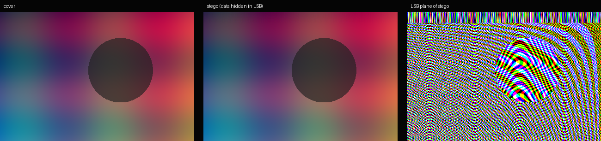

<div align="center">



**Детектор стеганографии в изображениях.**
Находит данные, спрятанные в картинке: в хвосте файла, в метаданных и в младших битах пикселей.

</div>

## Зачем это

В картинку можно спрятать текст, архив или ключ так, что глазами это не отличить. Типичные приёмы: дописать данные после конца файла, засунуть их в метаданные или переписать младшие биты пикселей (LSB). `shroud` ищет все три и объясняет, на чём основан вывод. Это инструмент для форензики, CTF и проверки того, что утекает через картинки.

<div align="center">

<sub>слева оригинал, посередине то же изображение с 3,6 КБ скрытых данных, справа плоскость младших битов: зашумлённая полоса вверху это и есть данные</sub>
</div>

## Что проверяется

| уровень | что ищет |
| :-- | :-- |
| **структура файла** | PNG, JPEG, GIF, BMP: данные после `IEND`/`EOI`/трейлера, лишнее внутри потока `IDAT`, нестандартные и приватные чанки, длинные комментарии, неверные CRC |
| **вложения** | сигнатуры ZIP, RAR, 7z, gzip, PDF, ELF, SQLite, PEM и др. в хвосте и в метаданных, энтропия хвоста, base64 в метаданных |
| **извлечение из LSB** | читает младшие биты в типичных порядках (каналы, плоскости 1–3, MSB/LSB, по строкам и столбцам), как `zsteg`, и ищет текст и файловые сигнатуры |
| **статистика пикселей** | RS-анализ (Fridrich, Goljan, Du) оценивает долю заполненных LSB, профиль хи-квадрата по долям изображения ловит частичное встраивание |

Вердикт четырёх уровней: чисто, странности, подозрительно, вероятно стего. Каждое утверждение сопровождается причиной.

## Запуск

```bash
python3 -m venv .venv && .venv/bin/pip install -r requirements.txt
.venv/bin/python -m shroud scan photo.png            # файл
.venv/bin/python -m shroud scan ./folder --json      # папка, вывод в JSON
.venv/bin/python -m shroud lsb-plane photo.png out.png   # плоскость младших битов как картинка
.venv/bin/python -m pytest
```

Код возврата `1`, если найдено «подозрительно» или «вероятно», так что инструмент пригоден для скриптов и CI.

Пример на `assets/demo-stego.png`:

```
assets/demo-stego.png  (png, 54462 байт)
  ▓ RS-анализ: LSB заполнены примерно на 6% (R=0.06, G=0.07, B=0.05)
  ▓ из младших битов (b1,rgb,msb,xy) читается текст: «flag{lsb_hides_in_plain_sight_but_not_from_shroud} the quick brown fox jumps ove»
  хи-квадрат по долям изображения: ▁▂█▅▂▂▂▁▁▁
  вердикт: вероятно, внутри спрятаны данные
```

## Как проверялось

- 16 тестов: каждый вид структурных находок, извлечение текста и файла из LSB, оценка RS на 0, 25 и 50% заполнения, хи-квадрат на «спиковом» оригинале, CLI и код возврата.
- Ложные срабатывания: 120 чистых синтетических изображений дали 0 тревог и 0 предупреждений после настройки порогов; три системных обоя macOS тоже чистые. Это не доказательство на реальных фотографиях, а проверка, что пороги не слишком нервные.
- Встраиватель для тестов лежит в `tests/helpers.py` и нужен только для проверки детектора.

## Ограничения

Лучше сказать сразу, чего здесь нет:

- **JPEG и GIF**: пиксельный анализ не применяется, проверяется только структура. DCT-стего (jsteg, outguess, F5) в v1 не ловится.
- **Полное заполнение шумного изображения случайными битами**: RS в этом режиме неустойчив, и такой случай может остаться без вердикта.
- **Очень короткие сообщения**: статистика их не видит. Спасает только извлечение из LSB, если сообщение читаемый текст в типичном порядке.
- **Шифрованные и сжатые данные в LSB** выглядят как шум и находятся только статистикой, а не извлечением.
- Пороги подобраны на синтетических и системных изображениях. На реальных фото возможны отдельные ошибки в обе стороны.

## Дальше

- DCT-анализ для JPEG (chi-square по коэффициентам)
- анализ индексов палитры для GIF и PNG-P
- плоскости других битов и пакетный отчёт в HTML
